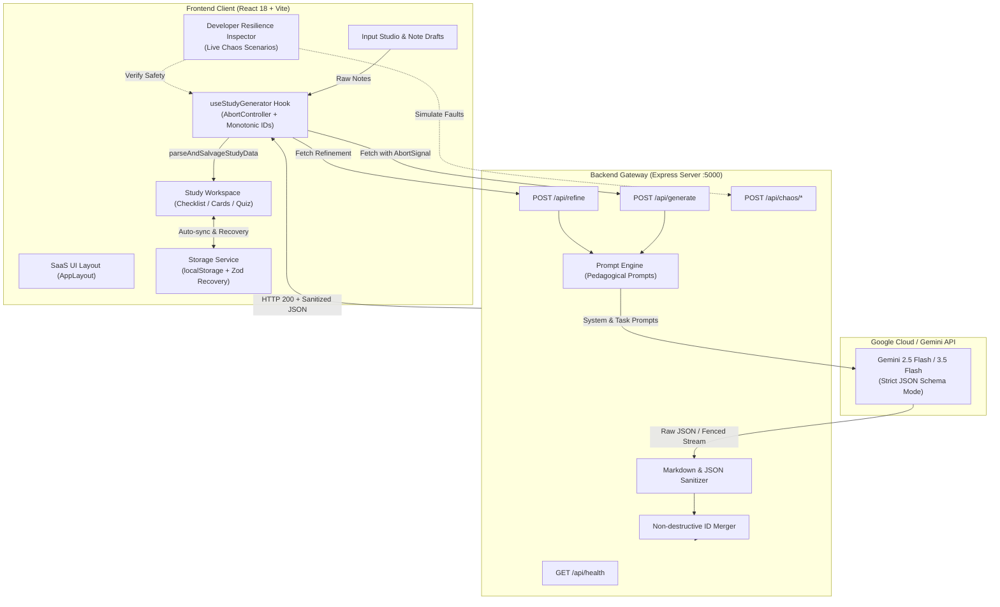

# Adaptive Active-Recall Studio ⚡🧠

> **A high-resilience, pedagogy-backed educational SaaS application that transforms raw, unstructured study notes into interactive active recall workspaces—complete with Concept Checklists, 3D Flashcards, Diagnostic Quizzes (MCQ & Cloze), Visual Topic Breakdown charts, and Surgical AI Refinement.**

---

## Table of Contents
1. [Overview & Product Identity](#1-overview--product-identity)
2. [Tech Stack & Architecture](#2-tech-stack--architecture)
3. [Architecture Diagram](#3-architecture-diagram)
4. [Folder Structure](#4-folder-structure)
5. [Quickstart Guide](#5-quickstart-guide)
6. [Environment Configuration](#6-environment-configuration)
7. [Backend API Specification](#7-backend-api-specification)
8. [AI Prompts & Structured JSON Enforcement](#8-ai-prompts--structured-json-enforcement)
9. [Resilience Engine: Parsing & Partial Item Salvage](#9-resilience-engine-parsing--partial-item-salvage)
10. [Race-Condition & Stale Response Prevention](#10-race-condition--stale-response-prevention)
11. [Developer Resilience Inspector (`⚡ Test AI Resilience`)](#11-developer-resilience-inspector--test-ai-resilience)
12. [Interactive Study Workspace Modules](#12-interactive-study-workspace-modules)
13. [Keyboard Shortcuts](#13-keyboard-shortcuts)
14. [Local Storage Persistence & Safe Recovery](#14-local-storage-persistence--safe-recovery)
15. [Dark Mode & Responsive SaaS Layout](#15-dark-mode--responsive-saas-layout)
16. [Limitations & Boundary Conditions](#16-limitations--boundary-conditions)
17. [AI Disclosure & Pedagogical Ethics](#17-ai-disclosure--pedagogical-ethics)
18. [Roadmap & Future Enhancements](#18-roadmap--future-enhancements)

---

## 1. Overview & Product Identity

**Adaptive Active-Recall Studio** is deliberately designed as an **educational productivity SaaS application, NOT a conversational chatbot**. 

Instead of generating loose conversational text or unstructured prose, the application transforms raw notes, lecture transcripts, and documentation into structured, validated **StudyKits**. Every StudyKit feeds interactive learning widgets engineered around cognitive science principles:
- **Active Recall**: Testing oneself before looking at answers (3D Flashcards & Cloze drills).
- **Desirable Difficulty**: Calibrating questions across easy, medium, and hard tiers.
- **Diagnostic Immediate Feedback**: Explaining *why* an answer is correct or incorrect instantly.
- **Targeted Misconception Remediation**: Surgical AI refinement that fixes only missed concepts without regenerating or resetting the entire session.

---

## 2. Tech Stack & Architecture

- **Frontend**:
  - **React 18**: Component-driven architecture using functional components and custom hooks (`useStudyGenerator`, `useQuizRunner`).
  - **Vite 6**: Ultra-fast build tool and dev proxy.
  - **Tailwind CSS 3**: Clean, academic-productivity design system inspired by Notion and Linear.
  - **Recharts 2**: Interactive SVG data visualizations for topic coverage and difficulty distribution.
  - **Lucide React**: Modern, crisp iconography.
  - **Zod 3**: Shared schema validation engine enforcing strict item contracts.
- **Backend Express Gateway**:
  - **Node.js (ES Modules)** & **Express 4**: Secure API proxy running on `http://127.0.0.1:5000`.
  - **Google Gemini API**: Direct SDK integration targeting `gemini-2.5-flash` with automatic fallback migration to `gemini-3.5-flash`.
  - **Dotenv**: Environment variable isolation (protecting API keys from browser exposure).
  - **CORS**: Origin verification.
- **Resilience & Testing**:
  - **Node.js native test suite**: 7 unit test suites with zero external test runners needed.

---

## 3. Architecture Diagram



---

## 4. Folder Structure

```
Frontend_Study_Assistant_Project/
├── .env                              # Backend environment secrets (NEVER exposed to client)
├── .env.example                      # Template for setup
├── package.json                      # Workspace scripts and dependencies
├── tailwind.config.js                # Tailwind styling configurations
├── vite.config.js                    # Vite configuration with proxy to port 5000
│
├── server/                           # Backend Express Gateway
│   ├── index.js                      # Express app initialization & port binding
│   ├── middleware/
│   │   └── errorHandler.js           # Sanitized error handler (redacts credentials)
│   ├── routes/
│   │   ├── healthRoutes.js           # GET /api/health endpoint
│   │   ├── studyRoutes.js            # POST /api/generate & POST /api/refine endpoints
│   │   └── chaosRoutes.js            # POST /api/chaos/* endpoints for resilience testing
│   └── services/
│       ├── geminiService.js          # Direct Gemini API integration & retry fallback
│       └── prompts.js                # Pedagogical system prompts & refinement templates
│
├── shared/                           # Shared Data Contracts & Schemas
│   ├── fixtures/
│   │   └── studyKitFixtures.js       # Valid & corrupted fixtures for tests
│   └── schemas/
│       ├── health.js                 # HealthCheckResponseSchema
│       ├── index.js                  # Shared exports
│       └── studyKit.js               # Strict & partial Zod schemas for StudyKit
│
├── src/                              # Frontend React Application
│   ├── App.jsx                       # Root view manager & persistence coordinator
│   ├── main.jsx                      # DOM mount point
│   ├── components/
│   │   ├── breakdown/
│   │   │   └── TopicBreakdownChart.jsx # Recharts visualization of syllabus coverage
│   │   ├── checklist/
│   │   │   └── ConceptChecklistView.jsx# Interactive mastery checklist
│   │   ├── flashcards/
│   │   │   └── FlashcardEngine.jsx   # 3D CSS flip card engine with keyboard controls
│   │   ├── input/
│   │   │   └── StudyInputStudio.jsx  # Raw note editor with presets & draft autosave
│   │   ├── layout/
│   │   │   ├── AppLayout.jsx         # SaaS container with responsive navigation
│   │   │   ├── Sidebar.jsx           # Desktop/mobile collapsible navigation drawer
│   │   │   └── TopNavbar.jsx         # Connection status & theme switcher
│   │   ├── overview/
│   │   │   └── StudyKitOverview.jsx  # Summary metrics & source notes viewer
│   │   ├── quiz/
│   │   │   ├── ClozeCard.jsx         # Fill-in-the-blank card with normalization
│   │   │   ├── MCQCard.jsx           # 4-option single choice card with keys 1-4
│   │   │   ├── QuizCompletionScreen.jsx # Results summary & Retest mode trigger
│   │   │   └── QuizEngine.jsx        # Quiz orchestrator & progress dashboard
│   │   ├── refinement/
│   │   │   └── RefinementBar.jsx     # Surgical AI prompt input with quick pills
│   │   ├── resilience/
│   │   │   └── ResilienceInspector.jsx# Developer Chaos Test Panel
│   │   ├── sessions/
│   │   │   └── StudySessionsView.jsx # Session manager, clear modal & JSON exporter
│   │   ├── settings/
│   │   │   └── SettingsView.jsx      # Theme, model, and security inspector
│   │   └── workspace/
│   │       └── StudyWorkspace.jsx    # Segmented study hub
│   ├── hooks/
│   │   ├── useQuizRunner.js          # State machine for quiz & retest mode
│   │   └── useStudyGenerator.js      # Concurrency & AbortController request manager
│   ├── services/
│   │   ├── apiClient.js              # Fetch client with timeout controls
│   │   └── storageService.js         # localStorage wrapper with Zod schema recovery
│   ├── styles/
│   │   └── index.css                 # Tailwind directives & 3D card CSS transforms
│   └── utils/
│       └── parseAndSalvageStudyData.js# Markdown fence stripper, truncated JSON repair & salvage
│
└── test/                             # Comprehensive Automated Unit Test Suites
    ├── testValidation.js             # Zod schema validation & partial recovery
    ├── testEndpoints.js              # Backend JSON sanitizer & non-destructive merger
    ├── testSalvageUtility.js         # Truncated, malformed & markdown repair unit tests
    ├── testUseStudyGenerator.js      # Hook race condition & abort tests
    ├── testQuizEngine.js             # MCQ locking, Cloze whitespace normalization & Retest mode
    ├── testSurgicalRefinement.js     # Surgical ID-targeted refinement tests
    └── testLocalStorageRecovery.js   # Local storage corrupted data recovery & draft tests
```

---

## 5. Quickstart Guide

### Prerequisites
- **Node.js**: v18.0.0 or higher
- **npm**: v9.0.0 or higher
- **Gemini API Key**: Obtainable from [Google AI Studio](https://aistudio.google.com/)

### Step 1: Install Dependencies
```bash
npm install
```

### Step 2: Configure Environment
Copy `.env.example` to `.env` and fill in your Gemini API key:
```bash
cp .env.example .env
```
Ensure your `.env` contains:
```ini
GEMINI_API_KEY=AIzaSyYourActualKeyHere
GEMINI_MODEL=gemini-2.5-flash
PORT=5000
```

### Step 3: Run the Application
Start both the Express backend gateway and the Vite frontend concurrently:
```bash
npm start
```
- Frontend client: **`http://localhost:5173`**
- Express backend gateway: **`http://127.0.0.1:5000`**

### Step 4: Run the Test Suites
Execute the complete automated test suite (7 suites, 60+ assertions):
```bash
npm test
```

---

## 6. Environment Configuration

All credentials reside strictly on the server in `.env`. **The client browser never accesses or stores `GEMINI_API_KEY`**.

| Variable | Default Value | Description |
| :--- | :--- | :--- |
| `GEMINI_API_KEY` | *(Required)* | Google AI Studio API Key. |
| `GEMINI_MODEL` | `gemini-2.5-flash` | Primary Gemini model. Gateway includes auto-fallback to `gemini-3.5-flash`. |
| `PORT` | `5000` | Port bound by Express server (`0.0.0.0:5000`). |

---

## 7. Backend API Specification

### 1. `GET /api/health`
Checks server status, uptime, and configuration.
- **Response `200 OK`**:
```json
{
  "status": "ok",
  "model": "gemini-2.5-flash",
  "hasKey": true,
  "uptime": 142.5,
  "timestamp": "2026-11-15T18:20:00.000Z"
}
```

### 2. `POST /api/generate`
Generates a full StudyKit from raw unstructured notes.
- **Request Body**:
```json
{
  "sourceText": "Mitochondria are double-membrane-bound organelles...",
  "options": {
    "title": "Cellular Respiration"
  }
}
```
- **Response `200 OK`**:
```json
{
  "studyKit": {
    "id": "kit-1731694800000",
    "title": "Cellular Respiration",
    "sourceText": "...",
    "conceptChecklist": [...],
    "flashcards": [...],
    "quizQuestions": [...],
    "topicBreakdown": [...]
  },
  "warnings": [],
  "recovered": false
}
```

### 3. `POST /api/refine`
Surgically updates targeted elements of an existing StudyKit without full regeneration.
- **Request Body**:
```json
{
  "currentStudyKit": { ... },
  "instruction": "Simplify explanations and add mnemonics for missed items",
  "targetItemIds": ["fc-2", "q-mcq-1"]
}
```
- **Response `200 OK`**:
Returns updated `studyKit` where targeted items are modified, unaffected items are preserved intact, and existing user IDs are preserved.

### 4. `POST /api/chaos/:scenario`
Developer test endpoint for the Resilience Inspector.
- Scenarios: `race`, `malformed`, `wrong-schema`, `failure`.

---

## 8. AI Prompts & Structured JSON Enforcement

The backend uses strict pedagogical system prompts (`server/services/prompts.js`):
1. **JSON Only Directive**: Enforces strict JSON output with no preamble, conversational banter, or markdown fences.
2. **Pedagogical Standards**:
   - **Checklist**: Atomic concept definitions.
   - **Flashcards**: Front question, back concise answer, and vivid mnemonic hint.
   - **MCQs**: Exactly 4 plausible distractors, immediate pedagogical rationale, and guaranteed inclusion of `correctAnswer` in `options`.
   - **Cloze**: Sentence with single unambiguous blank and precise answer string.
   - **Topic Breakdown**: Relative coverage percentage summing to 100%.

---

## 9. Resilience Engine: Parsing & Partial Item Salvage

The client-side utility `src/utils/parseAndSalvageStudyData.js` handles real-world LLM output imperfections without crashing:

1. **Markdown Fence Stripping**:
   Safely strips ```json and ``` fences, even when surrounding text or whitespace is present.
2. **Conservative Truncated JSON Repair**:
   If an LLM stream cuts off mid-generation (e.g. hitting a token limit), the repair utility closes open string quotes, unclosed arrays `]`, and unclosed objects `}` without ever calling `eval()`.
3. **Partial Item Salvage (Item-Level Zod Validation)**:
   If 5 flashcards arrive and 2 have missing fields or invalid enums, the engine **does NOT drop the entire kit**. It accepts the 3 valid cards, rejects the 2 broken cards, and attaches clear diagnostic warnings.
4. **Zero Hallucination Defaults**:
   The engine will never hallucinate or invent fake answers to fill broken data.

---

## 10. Race-Condition & Stale Response Prevention

To solve common asynchronous state bugs when users trigger multiple requests in quick succession:
1. **`AbortController` In-Flight Cancellation**:
   Starting a new request automatically aborts the prior in-flight fetch via `AbortController.abort()`.
2. **Monotonically Incrementing Request IDs**:
   Each request receives a unique integer ID (`requestId = ++latestRequestIdRef.current`).
3. **Stale Completion Guard**:
   When an API response returns, the hook verifies `if (thisRequestId !== latestRequestIdRef.current) return;`. Even if a slow request completes after a newer fast request, the slow response is discarded and cannot overwrite user state.
4. **Timeout Distinction**:
   Distinguishes between user cancellations, superseding cancellations, and genuine network timeouts (default 60s).

---

## 11. Developer Resilience Inspector (`⚡ Test AI Resilience`)

Accessible via the sidebar or top navigation, this developer panel allows live verification of all fault-tolerance mechanisms:

1. **Test 1: Race Condition Simulator**
   - Fires Request A (4-second delay), then immediately fires Request B (1-second delay).
   - Verifies Request A is aborted, Request B finishes first, and only Request B commits to state.
2. **Test 2: Malformed / Truncated JSON**
   - Injects truncated JSON cut off inside an array.
   - Verifies conservative bracket repair rescues valid items without UI crash.
3. **Test 3: Wrong Schema Shape**
   - Injects a payload with 5 flashcards (3 valid, 2 invalid).
   - Verifies 3 valid cards render in the workspace while 2 broken cards are rejected with warning pills.
4. **Test 4: Timeout & API Failure**
   - Injects an HTTP 500 server error and simulates a network drop.
   - Verifies the user's existing StudyKit remains completely intact and a non-destructive retry banner appears.

---

## 12. Interactive Study Workspace Modules

### 1. Concept Checklist
- Checkbox tracking with instant progress percentage and completed/total counters.
- Bulk actions: "Mark All Complete" and "Reset".
- Filter pills: All, Completed, Pending.

### 2. 3D Flashcard Engine
- CSS 3D perspective flip animation (`rotateY(180deg)`).
- Front: Question. Back: Answer + Mnemonic anchor.
- Confidence tracking: **"Got It" (Mastered)** vs. **"Needs Review" (Challenging)**.
- Tracks `userAttempts` and status independently from quiz questions.

### 3. Visual Topic Breakdown
- Powered by **Recharts**.
- Displays horizontal distribution of topic coverage with color-coded difficulty indicators (`Easy` = Green, `Medium` = Amber, `Hard` = Rose).

### 4. Diagnostic Quiz Engine
- **Multiple Choice Questions (MCQ)**: 4 options, single-selection lock, instant visual feedback (green/red), and full explanatory analysis.
- **Fill-in-the-Blank (Cloze)**: Normalizes input case and whitespace before evaluating.
- **Retest Wrong Answers Mode**: Isolates only questions marked `status: 'wrong'`, preserves original question IDs, enables focused practice, and seamlessly merges updated scores back into the overall quiz session.
- **Simplify Missed Items with AI**: Surgically sends missed question IDs to the backend for simpler explanations and analogies.

---

## 13. Keyboard Shortcuts

Designed for high-speed, distraction-free study:

| Context | Key | Action |
| :--- | :--- | :--- |
| **Flashcards** | `Space` / `Enter` | Flip active card |
| **Flashcards** | `←` (Left Arrow) | Previous card |
| **Flashcards** | `→` (Right Arrow) | Next card |
| **Flashcards** | `1` / `y` | Mark "Got It" (Confidence +1) |
| **Flashcards** | `2` / `n` | Mark "Needs Review" |
| **Quiz (MCQ)** | `1`, `2`, `3`, `4` | Select options A, B, C, or D |
| **Quiz (MCQ)** | `Enter` / `→` | Advance to next question after answering |

> **Accessibility Guard**: Keyboard listeners automatically disable whenever the user is actively typing in an `<input>` or `<textarea>`.

---

## 14. Local Storage Persistence & Safe Recovery

All study progress is automatically saved to the browser's `localStorage` (`activeRecall_studio_session_v1`):
- **Persisted Elements**: StudyKit contents, concept checklist checkboxes, flashcard confidence stats, quiz question progress & attempt counts, draft notes, and theme preference.
- **Safety Guard**: Initial mount never overwrites existing saved sessions with null/empty state.
- **Corrupt Storage Defense**: If corrupted JSON is detected in `localStorage`, `loadStudySession()` validates the payload through `validateAndRecoverStudyKit()`, safely discarding unrecoverable items without throwing an uncaught exception.
- **Clear Session with Confirmation**: Users can wipe their session via a styled confirmation modal in the "My Study Sessions" view.
- **Export Kit**: Users can export their full StudyKit as a formatted `.json` file at any time.

---

## 15. Dark Mode & Responsive SaaS Layout

- **Persistent Theme**: Toggle between Light and Dark mode via the top navigation bar or settings. Preference is saved in `localStorage.activeRecall_theme`.
- **Responsive Navigation**: Full sidebar on desktop; collapsible slide-over drawer on mobile and tablet.
- **Strict Visual Discipline**: Follows modern academic productivity design (clean borders, neutral backgrounds, high-contrast typography, no distracting neon gradients).

---

## 16. Limitations & Boundary Conditions

1. **Maximum Input Size**: Recommended note size is between 10 and 50,000 characters.
2. **Single Active Session**: Currently supports one active working session in `localStorage` at a time (previous kits can be exported as `.json`).
3. **API Rate Limits**: Governed by the user's Google AI Studio tier limits.
4. **Network Dependency**: Generation and surgical refinement require an active internet connection to communicate with Gemini.

---

## 17. AI Disclosure & Pedagogical Ethics

- **No Hallucinated Grades**: The app never pretends to score subjective essays; all questions are strictly validated against the source notes provided by the user.
- **Confidence vs. Correctness**: Flashcard self-ratings ("Got It") are strictly separated from objective Quiz accuracy percentages.
- **Privacy**: Raw study notes are transmitted exclusively to Google's Gemini API over HTTPS and are never logged or stored on any third-party telemetry server.

---

## 18. Roadmap & Future Enhancements

- [ ] **Multi-Deck Library**: Organize multiple saved study kits by course or semester.
- [ ] **Spaced Repetition Scheduler**: Integration of the SM-2 or FSRS algorithm for daily review intervals.
- [ ] **Document Import**: Direct PDF, EPUB, and audio lecture transcript upload.
- [ ] **Audio Pronunciation & TTS**: Web Speech API integration for language flashcards.

---

*Built with ❤️ for focused, high-retention learning.*

